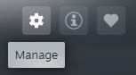
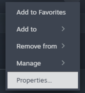
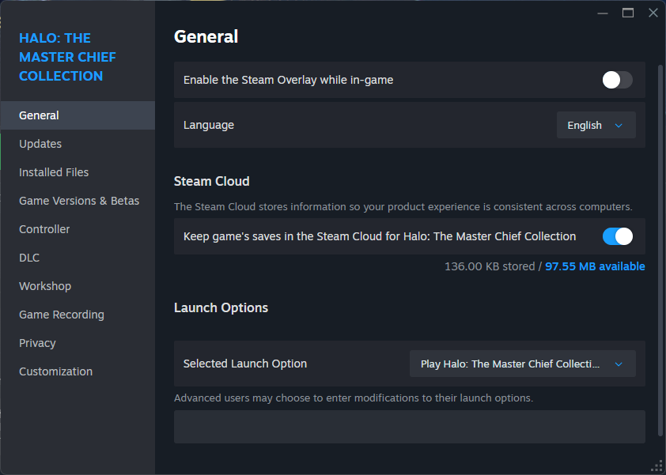

# Halo: MCC Cloud Save Fix

Use this guide if your settings in Halo: The Master Chief Collection don't persist between launches. It resets your local save data, then re-syncs it with Steam Cloud.

> **Heads up:** This resets your in-game settings, so you'll need to set them again in step 5. Back up the folder in step 2 first if you want to be safe.

## 1. Disable Steam Cloud for the game

1. Open Steam and go to the **Library**.
2. Select **Halo: The Master Chief Collection**.
3. Click the **Manage** button (gear icon) and select **Properties**.

   

4. Open the **General** tab.

   

5. Toggle **off** "Keep game's saves in the Steam Cloud for Halo: The Master Chief Collection".

   

## 2. Delete the local save data

1. **Close the game completely** if it's running.
2. Open File Explorer, paste the following path into the address bar, and press Enter. Replace `<YOUR_STEAM_ID>` with your own Steam ID:

   ```
   %ProgramFiles(x86)%\Steam\userdata\<YOUR_STEAM_ID>\976730
   ```

   - If you installed Steam somewhere other than the default location, start from your own Steam folder instead.
   - **Finding your Steam ID:** Look inside `...\Steam\userdata`. Each numeric folder name is an ID. If there's more than one, use the most recently modified folder. This is the short account number, not the 17-digit SteamID64.

3. **Optional backup:** Copy the `976730` folder to your desktop.
4. Delete everything **inside** the `976730` folder (not the folder itself).

## 3. Create fresh local save data

1. Launch Halo: The Master Chief Collection and sign in to your account.
2. Close the game.
3. Go back to `%ProgramFiles(x86)%\Steam\userdata\<YOUR_STEAM_ID>\976730`.

**Expected result:** Exactly **one** new folder was created. If you see more than one, delete the contents again and repeat this step.

## 4. Re-enable Steam Cloud

1. Repeat the steps from section 1, but toggle **on** "Keep game's saves in the Steam Cloud for Halo: The Master Chief Collection".
2. Back on the Library page, find the **Cloud Status** section next to the Play button and click it.
3. When prompted, choose to **upload your local data to the cloud**. This replaces the old cloud data with your fresh local data.

## 5. Test that settings persist

1. Launch the game and set all your preferred settings.
2. Close the game fully, then launch it again.
3. Check that your settings are still applied.

If they persisted, you're done. If not, [add what to try next, e.g. where to ask for help].